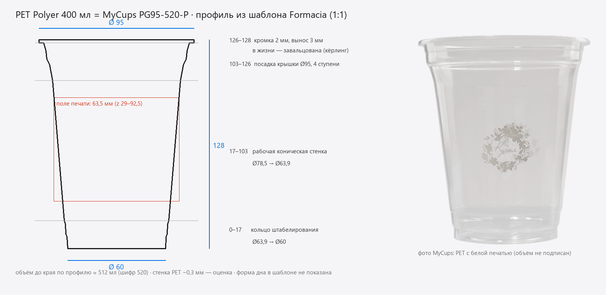

# PET Polyer 400 мл: размеры на согласование

Статус 2026-09-25: **согласовано**. Допущения таблицы ниже приняты. Серия PET —
три стакана: PG95-400, PG95-520, PG95-600 (объём до края). Печать только с двух
сторон, А и Б. Модели построены: `cups/pet/`, см. [README](../../cups/pet/README.md).

## Сверка с образцами (фото 2026-09-25)

Восемь фото реальных стаканов: 500 мл и 400 мл (на дне выдавлено «500ml» /
«400ml»), 400 мл с двусторонней чёрной печатью.

- Пропорции совпадают: на фронтальных фото дно к верху 0,60–0,62, у модели 0,63.
- Кольца посадки крышки и ступенька штабелирования у дна — как в модели.
- Печать: непрозрачная чёрная краска, задняя сторона видна сквозь стакан
  зеркально — рендер считает так же.
- **Добавлено по фото:** дно не выгнутое, а с плоским опорным кольцом и
  утопленным диском; на диске клеймо — объём, PET-1, «бокал-вилка», номер гнезда
  формы, в центре знак производителя (не рисуется, см. `cups/pet/README.md`).
- Имена по объёму до края совпали с тем, что выдавлено на дне: «400ml» — это
  PG95-520, «500ml» — PG95-600.

## Что это за стакан

«Стакан-шейкер Polyer 400 мл ПЭТ прозрачный» производства «Стиролпласт» (торговая
марка Polyer) — это тот же стакан, что у MyCups идёт под шифром **PG95-520-P**
(«400 ml, тип стакана: пластиковый»). Число 520 в шифре — объём до края. Это и
есть «400 (500)» из вашего описания.

Совпадение проверено по трём независимым источникам:

| источник | верх | низ | высота |
|---|---|---|---|
| polyer.ru, каталог и презентация | Ø95 | — | 128 |
| шаблон MyCups/Formacia PG95-520-P (векторный, 1:1) | Ø95 | Ø60 | 128 |
| шаблон PG95-400-P (300 мл) против Polyer 300 мл | Ø95 / Ø95 | Ø57 / — | 107 / 107 |

У одного из продавцов для 400 мл указано «⌀95/57×128». Ø57 — это дно стакана на
300 мл. Для 400 мл по чертежу Formacia дно Ø60.

## Профиль

Чертёж в шаблоне нарисован в масштабе 1:1. Профиль снят с векторных линий PDF,
точность около 0,01 мм. Радиус r и высота z от дна, в мм:

| z | r | что здесь |
|---|---|---|
| 0 | 30,00 | дно, Ø60 |
| 7 | 30,47 | кольцо штабелирования |
| 9 | 31,13 | |
| 15 | 31,41 | |
| 17 | 31,96 | начало рабочей стенки |
| 103 | 39,24 | конец рабочей стенки |
| 113 | 41,10 | посадка крышки, ступени |
| 116 | 42,66 | |
| 121 | 43,25 | |
| 126 | 44,53 | под кромкой |
| 126–128 | 47,50 | кромка: 2 мм по высоте, вынос 3 мм, Ø95 |

- **Проверка объёмом:** по этому профилю объём до края выходит около 512 мл при
  шифре 520. Для 300 мл тем же способом — 416 мл при номинале 400. Размеры
  внутренне согласованы.
- **Верхние 25 мм** (посадка крышки) у 300 и 400 мл совпадают до сотых. Поэтому
  все крышки Polyer Ø95 подходят к обоим стаканам: купол 40 мм, плоская 13,5 мм.
- **Поле печати** (по шаблону): от z = 29 до z = 92,5 мм, высота 63,5 мм. Полей
  два, сторона А и сторона Б, а не печать по кругу. Безопасная зона — полоса
  шириной 25 мм по центру каждого поля. В шаблоне до 4 цветов Pantone.

## Что в шаблоне не показано, и что я предлагаю

| что | предложение | как проверить |
|---|---|---|
| кромка | в шаблоне это прямоугольник 2×3 мм; у настоящего стакана кромка завальцована («кёрлинг»). Делаю валик Ø2 мм в тех же габаритах | фото кромки крупно |
| толщина стенки | 0,3 мм (типично для термоформованного PET); у кромки и дна толще | замер штангенциркулем |
| дно | плоское с небольшим прогибом внутрь 1 мм; ребристого узора нет | фото дна снизу |
| материал | прозрачный PET, IOR 1,575, глянец; печать — непрозрачная краска поверх | сравнение с фото MyCups (`kitchen`, `soroka`) |

## Что нужно от вас

1. «Ок» на размеры и на четыре предположения из таблицы выше.
2. Нужен ли сразу и PET 500 мл (Polyer Ø95 × 152)? Шаблона MyCups на него нет,
   профиль пришлось бы достраивать по фото, так что точность будет ниже.
3. Печать на PET — те же две стороны А/Б, что в шаблоне, или ещё и по кругу?

## Источники

- polyer.ru → Каталог → Стаканы ПЭТ; презентация «Новая линейка стаканов из ПЭТ»
- mycups.ru/docs/design-templates/PG95-520-P.pdf и PG95-400-P.pdf
- mycups.ru/produktsiya/plastikovye-stakany — фото работ
